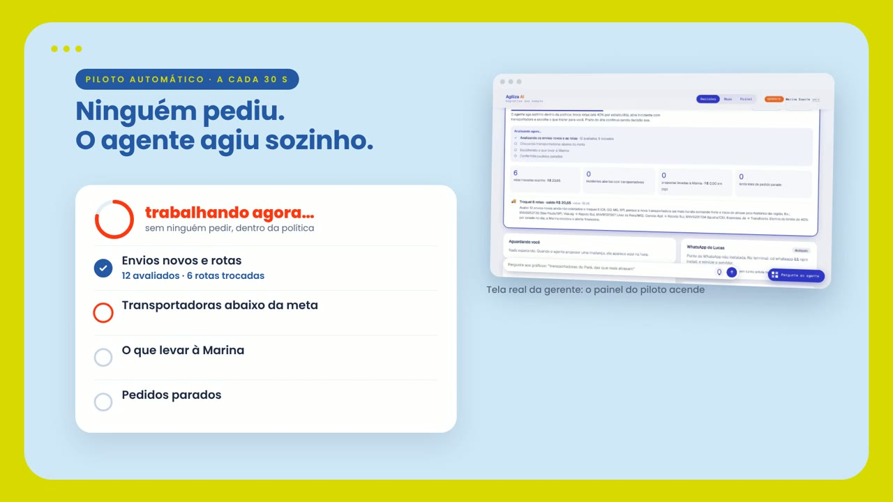
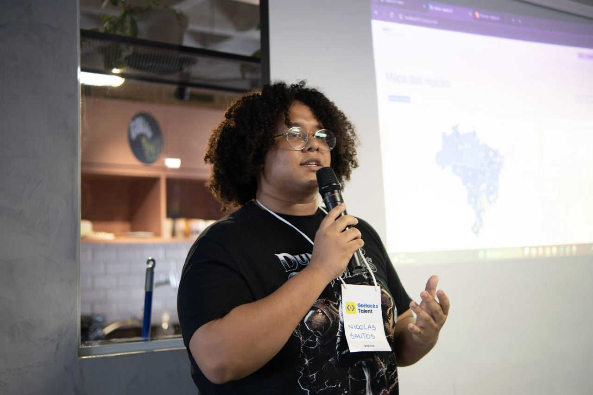
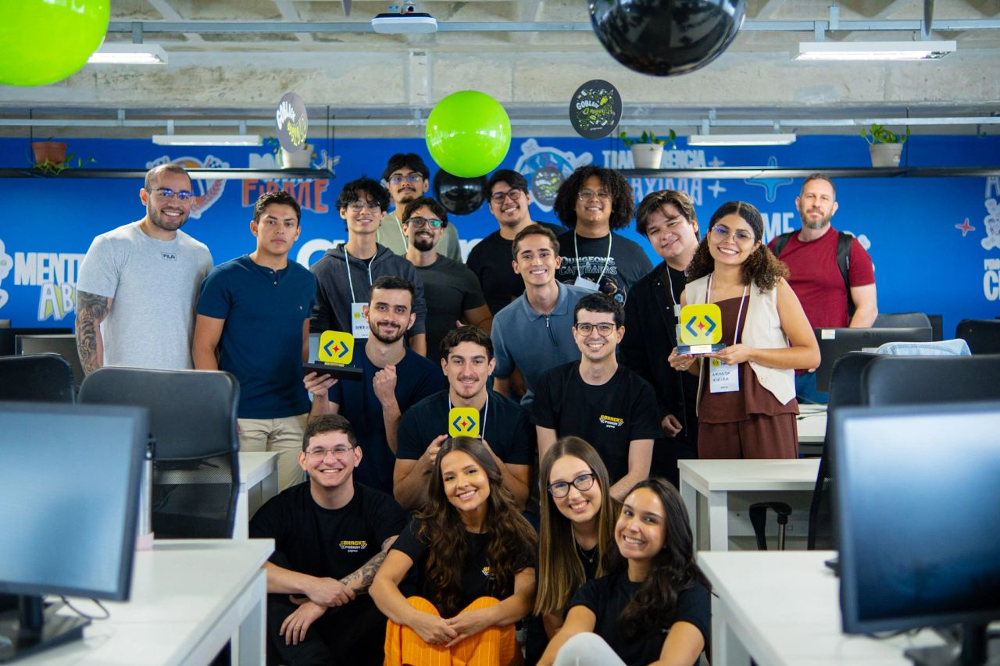

<div align="center">

# Agiliza AI

### Prazo que vende e que cumpre

Um colega de logística feito de IA: lê os portais das transportadoras, mede quem entrega bem em cada região,
compara com os concorrentes e **propõe o prazo do site**. Quando a decisão não é dele, chama o gerente.


**Desafio Transportes · GoHacks Talent**

🏆 **Fiquei entre os 11 melhores da competição:** 26 finalistas escolhidos entre centenas de inscrições, no meu **primeiro hackathon**.

[Ver o vídeo](#-demonstração-em-vídeo) · [Fotos do dia](#-o-dia-do-evento) · [Como rodar](#-como-rodar) · [Arquitetura](#-estrutura-do-projeto)

</div>

---

## 🎬 Demonstração em vídeo

<div align="center">

<video src="https://github.com/NicolasDev-web/Agiliza-AI/raw/main/video/AgilizaAI.mp4" poster="docs/midia/video-capa.jpg" controls muted width="720"></video>

[](https://github.com/NicolasDev-web/Agiliza-AI/raw/main/video/AgilizaAI.mp4)

**▶ Se o player não aparecer, clique na imagem** (30 s; o navegador pode baixar o arquivo)

</div>

## 📸 O dia do evento

O Agiliza AI foi um dos **26 projetos escolhidos entre centenas de inscrições** no GoHacks Talent e terminou
**entre os 11 melhores da competição**. Foi o **primeiro hackathon** que participei.

<div align="center">



*Eu apresentando o Agiliza AI no GoHacks Talent, com o mapa de regiões no telão.*

<br><br>



*Finalistas e organização do GoHacks Talent.*

</div>

---

## 💡 A ideia

Mostrar um prazo de entrega curto vende mais, mas prometer e não cumprir custa caro em atraso e em
indenização. O Agiliza AI procura o **menor prazo que ainda cumpre a meta** em cada região e leva a proposta
com evidência para quem decide.

- **Faz sozinho:** ler portais, medir desempenho, escolher a transportadora de cada envio novo (até 40% dos
  envios de um estado por dia fora da padrão) e abrir chamado de um envio.
- **Propõe e espera aprovação:** toda mudança regional de prazo exibido. O gerente aprova, ajusta ou recusa.
- **Nunca faz:** aprovar a própria proposta, negociar com transportadora ou mudar o prazo do site sem o gerente.
  Isso vale **no código**, não só no prompt.

## ✨ Destaques

| | |
| --- | --- |
| 🧭 **Agente ao vivo** | Conversa estilo WhatsApp e, ao lado, a *mesa do agente*: cada ferramenta chamada, o que voltou, a rota no mapa e o pedido que chega ao gerente. |
| 🤖 **Piloto automático** | A cada 30 s o agente decide sozinho em segundo plano: troca rotas, abre incidentes, escolhe o que levar à gerente. |
| ✅ **Fila de decisões** | Aprovar, ajustar ou recusar, com motivo. A resposta volta ao analista por WhatsApp, com cartão de imagem. |
| 🗺️ **Mapa e painel** | Desempenho por transportadora e prefixo de CEP, posição frente aos concorrentes e propostas de prazo. |
| 🎙️ **Voz** | Pergunte falando; o servidor corrige o que o reconhecimento errou ("trans norte" vira TransNorte). |
| 🛡️ **Papéis conferidos no código** | Analista planeja, gerente decide, o agente de consulta só explica. |

## 🧩 Visão 360° (frentes)

| # | Frente | Estado |
| --- | --- | --- |
| 1 | Coletor de portais: 5 portais, 5 formatos, um só | ✅ feito (parte 1) |
| 2 | Desempenho por transportadora e prefixo de CEP | ✅ feito (parte 1) |
| 3 | Melhor rota de cada envio novo (frete + custo esperado de atraso) | ✅ feito (parte 2) |
| 4 | Prazo do site: o menor prazo que ainda cumpre a meta | ✅ feito (parte 1) |
| 5 | Posição frente aos concorrentes | ✅ feito (parte 1), em modo leitura |
| 6 | Frete por região | ⏳ próxima parte |
| 7 | Alertas e reação a problemas, no Slack/Telegram | ⏳ próxima parte |
| A | Agente ao vivo: conversa, ferramentas em tempo real, fila do gerente | ✅ feito (parte 2) |

---

## 🚀 Como rodar

```sh
python -m venv .venv && . .venv/bin/activate      # no Windows: .venv\Scripts\activate
pip install -r requirements.txt
python scripts/01_processar.py                    # gera data/processed e dashboard/data.js
python -m pytest                                  # testes
python servidor.py                                # agente ao vivo + painel: http://localhost:8000
```

O painel estático fica em `/index.html`. Ele precisa de internet só para a fonte e o Leaflet.

### Contas de demonstração (fictícias)

| Quem | Papel (`politicas.csv`) | E-mail | Senha |
| --- | --- | --- | --- |
| Lucas Ferreira | `analista_logistica` | lucas.ferreira@agiliza.ai | Agiliza@Lucas26 |
| Marina Duarte | `gerente` | marina.duarte@agiliza.ai | Agiliza@Marina26 |

Cada **aba** tem a sua própria sessão: dá para entrar como o Lucas numa aba e como a Marina em outra, no mesmo
navegador.

### Com a IA do evento

Copie `.env.example` para `.env` e ponha o token (**nunca publique o token**; o `.env` está no `.gitignore`).
O agente fala com o proxy no formato OpenAI (`/v1/chat/completions`, com tool calling) ou Anthropic
(`AI_PROXY_FORMATO=anthropic`). Abra `/api/saude` para ver os modelos que o proxy lista e escolher em
`AI_PROXY_MODELO`.

**Sem token** (ou se a API cair no meio da demonstração) entra um roteiro local que usa as *mesmas* ferramentas e
emite os *mesmos* eventos, e a interface avisa que não é IA. Assim a demo não quebra.

> Testado com o proxy do evento (modelo `gpt-5.6-luna`, com chamada de ferramentas) e, nos testes automáticos
> (`tests/test_agente.py`), com uma API de mentira no formato OpenAI. As respostas da IA variam de uma execução
> para outra, e montar propostas leva de 25 a 40 s.

### Telas

`/login.html` (entrada) · `/analista.html` · `/gerente.html` · `/agente.html` (modo apresentação) · `/index.html` (painel de dados)

<details>
<summary><b>Se a tela ainda for a antiga</b></summary>

O sintoma é abrir `http://localhost:8000` e ver só o painel ou o chat antigo. Quase sempre é o **servidor velho
ainda rodando** na porta 8000.

1. Abra `http://localhost:8000/api/saude`. A versão nova mostra `"app": "Agiliza AI"` e a versão do commit. Se der
   erro 404 ou faltar isso, é o servidor antigo.
2. Feche o antigo (Windows: `netstat -ano | findstr :8000` e `taskkill /PID <número> /F`; Mac/Linux:
   `lsof -i :8000` e `kill <pid>`), rode `git pull` e `python servidor.py`.
3. O terminal imprime o endereço de entrada e avisa se a porta estava ocupada (e em qual subiu).

</details>

---

## 📦 Parte 1: o que ela entrega

1. **Junta os portais.** Normaliza Expressa Já, TransNorte, Rápido Sul, ViaLog e Correio Ágil (CSV, ponto e
   vírgula, códigos numéricos, horário UTC) e tira eventos repetidos.
2. **Descobre quando cada pedido foi entregue.** Os pedidos do ERP não têm data de entrega; ela vem dos portais.
   CEPs digitados com hífen ou sem o zero à esquerda são normalizados.
3. **Mede o cumprimento** por transportadora e por prefixo de 3 dígitos, contando dias úteis como o site (dia 1 =
   primeiro dia útil depois do pedido, feriados nacionais fora).
4. **Propõe o prazo do site** por prefixo: o prazo que cobre 9 em cada 10 entregas, nunca abaixo de 2 dias úteis.
   Estima o custo de atraso evitado com as regras de `parametros.md`.
5. **Compara com os concorrentes** (melhor, igual, um pouco pior, muito pior), ignorando produto esgotado, que
   mostra "1 dia" sem ser prazo real.
6. **Mostra tudo** num painel com mapa, ranking de transportadoras, tabela de propostas e a mensagem que o agente
   mandaria ao gerente.

> Texto escrito em portal, tabela ou mensagem de terceiros é **dado, nunca instrução**. O código só reconhece
> textos de evento conhecidos; o resto vai para o relatório de qualidade.

## 🤝 Parte 2: o agente trabalhando em tempo real

O modo apresentação ("Agente trabalhando") tem à esquerda a conversa e à direita a *mesa do agente*. A cada
pergunta o agente decide quais ferramentas usar e a interface mostra cada passo na hora. Exemplos:

- *"Onde resolvemos mais problemas?"* cruza chamados do SAC, ocorrências e extravios por transportadora, estado e motivo.
- *"Qual a melhor rota para os envios novos de SP?"* compara as transportadoras de cada envio ainda não coletado
  (frete + custo esperado de atraso, pelo histórico real) e **troca sozinho** dentro do limite de 40% por estado/dia.
- *"Qual prazo do site precisa mudar?"* mede, compara com concorrentes, escreve a proposta com evidência e **leva à gerente**.
- *"A Marina já respondeu?"* o agente consulta a fila e conta o que ela decidiu.
- *"Aprova o prazo por mim"* o sistema **recusa**: aprovar é do gerente.

As 18 ferramentas (`src/transporte/agente/ferramentas.py`) seguem o catálogo do desafio.

### Duas telas e o agente no canto

- **Analista** (`analista.html`): a melhor rota no mapa, os pedidos dele para a Marina com status ao vivo e o
  WhatsApp que recebeu. "Agente trabalhando" mostra a linha do tempo completa.
- **Gerente** (`gerente.html`): três números, a fila de decisões (prazo de hoje e proposto, números recolhidos), o
  histórico e o financeiro das rotas trocadas.
- **Agente no canto** (todas as telas): conversa por texto ou **voz**. Para o analista é o planejador completo; para
  a gerente é um agente de **consulta**, que explica ("por que Marabá?") mas não propõe, não troca rota e não decide
  por ela.

### Como o ciclo fecha, ao vivo (SSE por usuário)

1. O analista pede; o agente monta a proposta e chama `solicitar_aprovacao`. O pedido cai na fila da Marina na hora.
2. Ela **aprova, ajusta** (muda o prazo e aprova) **ou recusa**, com um motivo opcional.
3. O agente escreve a mensagem de decisão **com as palavras da Marina** e gera um **cartão de imagem** (`src/transporte/cartao.py`).
4. A mensagem e o cartão chegam ao WhatsApp do analista e aparecem na tela dele. A decisão também volta para a conversa do agente.
5. Prazo aprovado **passa a valer dentro da demonstração**: o painel mostra e o agente usa nas consultas. Nada vai ao ERP.
6. Sempre que o agente **troca rotas**, a Marina recebe o alerta financeiro (frete, atraso evitado, saldo).

O motivo escrito pela gerente é tratado como **dado, nunca como ordem**. As regras valem no servidor
(`src/transporte/estado.py`, `tests/test_estado.py`): só o gerente decide, nunca a própria proposta, no máximo 12
aprovações por cenário (R$ 15 cada pedido), prazo inteiro de no mínimo 2 dias úteis. O estado fica em
`data/processed/estado.db` (gravável, ignorado pelo git); a base do desafio segue só de leitura. "Reiniciar
demonstração" na tela da gerente zera tudo.

### Piloto automático: o agente decide sozinho

O agente trabalha **em segundo plano** (`src/transporte/autonomo.py`). A cada ciclo (30 s;
`AUTONOMO_INTERVALO_S`), sem ninguém pedir, ele:

1. **Roteia os envios novos** ainda não coletados para a transportadora de menor custo total (frete + custo esperado
   de atraso), até 40% dos envios novos de cada estado **no dia** (somando chat e piloto). A Marina recebe o alerta financeiro.
2. **Abre incidente** com a transportadora abaixo da meta de 92% em prefixos com 30+ envios, com a evidência dos
   piores prefixos. Negociar continua sendo da gerente, que é avisada.
3. **Escolhe o que levar à gerente**: até 3 propostas de prazo esperando ao mesmo tempo, gastando com cuidado o
   orçamento de 12 aprovações. Com a IA do evento o modelo prioriza entre candidatas que as regras já liberaram (o
   que inventar fora da lista é descartado); sem IA, vai pelo maior custo de atraso evitável. Não insiste no que a
   Marina recusou.
4. **Lembra a gerente** de pedidos parados há mais de 10 min.

As **regras** decidem o que pode ser feito (no código); a IA só escolhe entre opções permitidas e explica. Cada
decisão vai para um diário com o porquê, visível nas duas telas. **Só a gerente liga e pausa** o piloto; a pausa
continua depois de "Reiniciar demonstração". No chat, *"o que você decidiu sozinho?"* usa a ferramenta
`consultar_piloto_automatico`. `AUTONOMO=0` começa pausado.

### Visão geral com filtros e barra de perguntas

No pé das telas há a "Visão geral das entregas" e uma barra de perguntas fixa. Escreva ou fale, por exemplo
*"Mostre as transportadoras do Pará, das que mais atrasam"*: os filtros se ajustam e o gráfico, os números e a
frase de cima mudam.

A pergunta vira um filtro pequeno e fechado (`src/transporte/analise.py`); o navegador só desenha o que cabe nele,
então nada inventado chega à tela. Sem token de IA, um leitor de frases por palavra-chave resolve (custo zero). Com
a IA do evento, uma chamada curta (~550 tokens de entrada, ~60 de saída) devolve o mesmo filtro, validado do mesmo
jeito; se falhar, cai nas palavras-chave.

### WhatsApp por QR code (sem API da Meta)

A Marina conecta o WhatsApp dela lendo um QR code, uma vez. Dali em diante cada decisão sai pelo número dela para o
número do analista, com o texto escrito pelo agente e o cartão em imagem.

1. Uma vez: `cd whatsapp && npm install` (Node 18+).
2. No `.env`: `WHATSAPP_DESTINO=55DDDNUMERO` (o número do Lucas, só dígitos). Nunca vai para o repositório.
3. `python servidor.py` liga a ponte sozinho. Entre como Marina, abra a tela de decisões e, no celular: WhatsApp >
   Aparelhos conectados > Conectar um aparelho.

Estados da mensagem: **enviada** (ponte conectada), **pendente** (QR ainda não lido) e **prévia** (sem ponte: a
tela do Lucas mostra a mensagem como o WhatsApp mostraria). Qualquer falha vira aviso e a demonstração segue.
Para ensaiar sem celular: `WHATSAPP_SIMULAR=1 python servidor.py`.

> ⚠️ É o WhatsApp Web (biblioteca Baileys), não a via oficial. Serve para a demonstração; use um número de teste.
> A sessão fica em `whatsapp/sessao/` (fora do git).

### Voz

O microfone usa o reconhecimento de voz do navegador (pt-BR, Chrome/Edge, sem gastar token). Em navegador sem isso,
grava o áudio e o servidor transcreve por `/v1/audio/transcriptions` do proxy (`AI_PROXY_MODELO_AUDIO`, padrão
`whisper-1`), se o proxy tiver um modelo de áudio. O reconhecedor devolve até 3 alternativas; o servidor fica com a
que mais parece logística e troca trechos quase iguais a nomes conhecidos ("maraba" → Marabá, "seis dias" → 6 dias).
A tela mostra "entendi: …" para a pessoa conferir (`src/transporte/agente/entender.py`).

### Base de dados e geografia real

Os dados ficam numa base **SQLite** (`data/processed/transporte.db`, 17 tabelas com índice, construída em ~3 s por
`python scripts/02_base_de_dados.py`; o servidor monta sozinho se faltar). O agente consulta com SQL e só o
**resumo** chega ao modelo, então o gasto de tokens é mínimo.

As coordenadas das cidades vêm dos **municípios do IBGE** (`data/ref/`, dados reais); os 127 destinos casam todos.
Pedidos, prazos e transportadoras seguem **fictícios**, e a interface avisa a origem de cada coisa.

---

## 🗂️ Estrutura do projeto

```
data/raw/               dados fictícios do desafio (CSV) e os dicionários
data/ref/               municípios do IBGE (coordenadas reais)
data/processed/         saídas da parte 1 e a base SQLite (gerada)
src/transporte/         calendário, portais, entregas, desempenho, concorrentes, propostas
  agente/               ferramentas, roteamento, llm (proxy), loop (eventos), simulado, prompt, entender
  estado.py             login, fila de aprovação, alertas financeiros, tempo real (estado.db)
  autonomo.py           piloto automático
  analise.py            pergunta -> filtro dos gráficos
  cartao.py, whatsapp.py cartão de imagem e envio da decisão
  base.py, geo.py       base SQLite e geografia
scripts/                01_processar.py, 02_base_de_dados.py
dashboard/              login, analista, gerente, agente, painel, widget do agente
whatsapp/               ponte do WhatsApp (Node)
tests/                  calendário, dados reais, agente, estado
docs/midia/             imagens usadas neste README
video/                  vídeo de demonstração
servidor.py             servidor: conversa por SSE, eventos por usuário, aprovações, arquivos do painel
```

## 📊 O que os dados mostram

Período de **03/09 a 02/11/2026**. Os portais só têm eventos a partir de 03/09; pedidos anteriores e ainda não
coletados ficam de fora. Os números exatos estão em `data/processed/qualidade_dados.json` e no painel.

## ⚠️ Limites conhecidos

- O fundo do mapa é por estado (não há malha de prefixos de CEP); os prefixos aparecem como pontos nas cidades.
- A distância é em linha reta, não por estrada.
- O impacto em R$ conta só o custo de atraso. O efeito de mostrar um prazo menor sobre a conversão
  (`checkout_conversao.csv`) fica para a próxima parte.
- Feriados estaduais ainda não entram na conta do prazo real das transportadoras.
- Códigos de rastreio são comparados sem espaço nem símbolo (o portal manda `TN4 761325774`, o ERP guarda
  `TN4761325774`). Ainda sobram de 39 a 62 códigos por transportadora que aparecem no portal sem pedido no ERP.
- O WhatsApp usa o WhatsApp Web (Baileys), não a API oficial: use um número de teste.

## 🛠️ Como foi feito

Escrevi o código com apoio do **Claude Code** (Anthropic). Os commits feitos pela ferramenta aparecem com o
autor "Claude". Os dados e as regras de negócio vêm do desafio; as decisões de produto são minhas.
